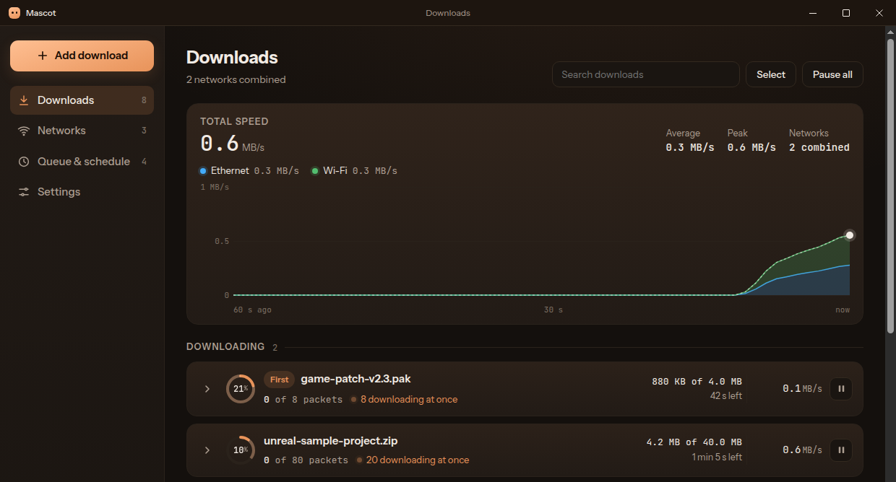
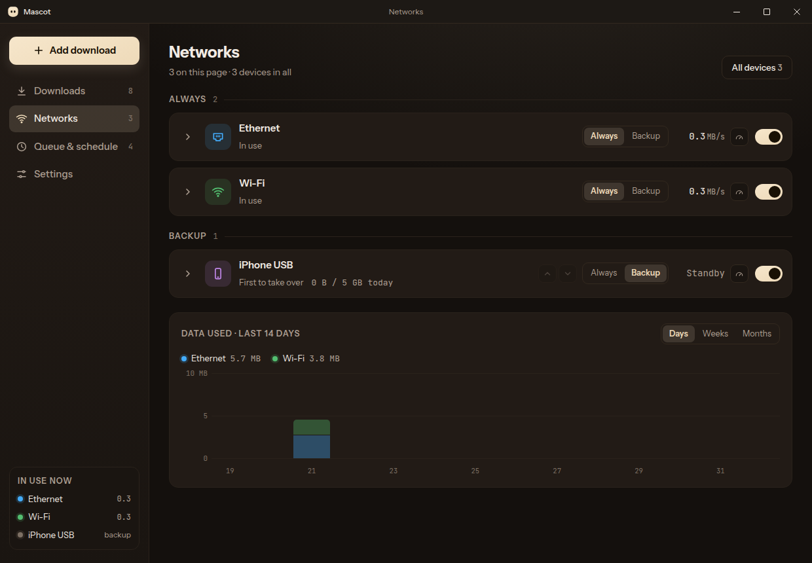

<h1 align="center">Mascot</h1>

Download files and torrents faster by using all your internet connections at once: 
Wi-Fi, Ethernet and your phone's connection, together.

<a href="https://github.com/alymurtza/mascot/releases"><b>Download</b></a> ·
<a href="https://chromewebstore.google.com/detail/jdbajgaajkoafbdfgnldbfmloclfgnjg"><b>Browser extension</b></a>

- **Every network at once.** Each file is split into pieces, and every network you allow
  fetches pieces at the same time.
- **Backup links.** The same file on other servers is used at the same time.
- **Backup networks.** A network kept in reserve takes over when your main ones drop.
- **Queue and schedule.** How many run at once, download hours, speed limits for set hours,
  and sleep or shut down when everything finishes.
- **Data limits** per network, and a history of the data each one used.
- **Torrents and magnet links**, with the files you choose.
- **Groups**: files that belong together show as one, to start, pause or delete at once.
  Paste many links and they're added in the background while you carry on.
- **Rules** choose the folder and name by file type, name or site.
- **Browser extension** for Chrome, Brave and Edge.
- **Picks up where it left off** after a dropped connection, a restart or a crash.

## Install

Download from the [Releases page](https://github.com/alymurtza/mascot/releases):

| System | File |
|---|---|
| Windows 10 and 11 | `Mascot-Downloader-Setup.exe` |
| Linux | `Mascot-Downloader-x86_64.AppImage` (any distribution) or `mascot-downloader_amd64.deb` (Ubuntu, Debian) |

A macOS version isn't available yet.

Mascot keeps itself up to date (Windows and the Linux AppImage). It looks for new versions, and
in **Settings → Updates** you choose whether it downloads them by itself or asks first, or check
by hand.

### "Windows protected your PC" and other warnings

Mascot is free and isn't code-signed yet (signing costs money every year), so your system
doesn't recognise who made it and may warn you or block it.

- **Windows SmartScreen** ("Windows protected your PC"): click **More info**, then
  **Run anyway**.
- **Windows Smart App Control** blocks unsigned apps outright, with no way to allow one. If it's
  on, Mascot can't be installed until it's switched off: **Windows Security → App & browser
  control → Smart App Control → Off**. Switching it off can't be undone without reinstalling
  Windows, so only do this if you're comfortable with that.
- **Your antivirus** may flag a new, unsigned download. If it does, you can allow it, or report
  it to the antivirus maker as a false positive.
- **Linux**: make the AppImage executable (`chmod +x Mascot-Downloader-*.AppImage`), or install
  the `.deb`.

## Browser extension

The extension sends your browser downloads to Mascot. It needs the Mascot app installed.

- **Chrome, Brave, Edge**: [Mascot on the Chrome Web Store](https://chromewebstore.google.com/detail/jdbajgaajkoafbdfgnldbfmloclfgnjg)
  (Edge asks you to allow extensions from other stores first).

Downloads go to Mascot as they start, or right-click a link, magnet link, image or video and
choose **Download with Mascot**. While Mascot is closed, downloads wait in the extension and go over
when it opens.

## Help

Found a problem or have an idea? [Open an issue](https://github.com/alymurtza/mascot/issues).

## Privacy

Mascot sends nothing about you anywhere. See the [privacy policy](PRIVACY.md).

## Licence

Mascot is MIT-licensed: see [LICENSE](LICENSE). It includes open-source libraries and fonts,
each under its own licence, listed with their licence texts in
[THIRD_PARTY_NOTICES.md](THIRD_PARTY_NOTICES.md) (also in the app: Settings → Open-source
licences).
